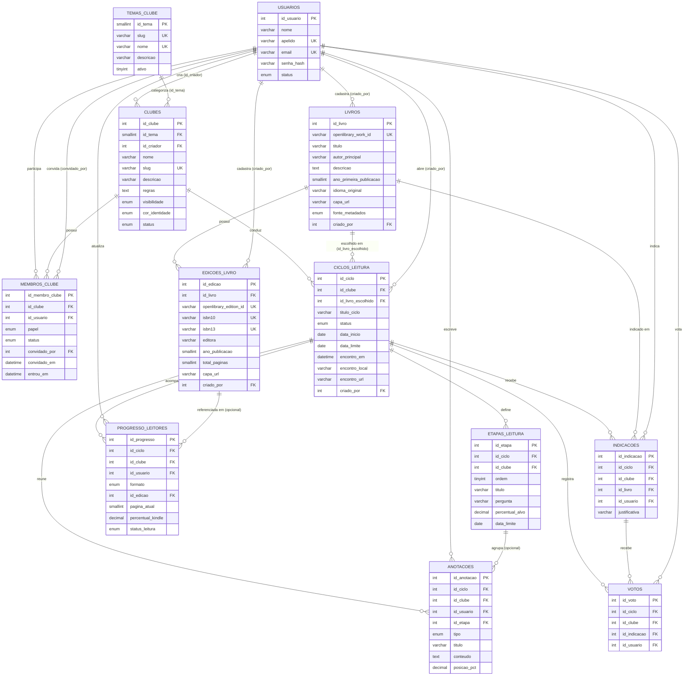

# Diagrama Entidade-Relacionamento (DER) — Laço de Papel

Modelo relacional do MVP acadêmico com **12 tabelas** em `InnoDB` (`utf8mb4_unicode_ci`).

## 1. Diagrama Mermaid

## 2. Resumo das 12 Tabelas e Regras de Integridade

| # | Tabela | Chave Primária | Chaves Únicas / Integridade Principal | Papel no Sistema |
|---:|---|---|---|---|
| 1 | `usuarios` | `id_usuario` | `UNIQUE(apelido)`, `UNIQUE(email)` | Contas globais dos leitores; `apelido` permite convites privados. |
| 2 | `temas_clube` | `id_tema` | `UNIQUE(slug)`, `UNIQUE(nome)` | Catálogo controlado de temas para descoberta de clubes. |
| 3 | `clubes` | `id_clube` | `UNIQUE(slug)`, FKs `id_tema`, `id_criador` | Comunidades públicas ou privadas independentes. |
| 4 | `membros_clube` | `id_membro_clube` | `UNIQUE(id_clube, id_usuario)` | Resolve relação N:N, define `papel` por clube e registra convites (`status='pendente'`). |
| 5 | `livros` | `id_livro` | `UNIQUE(openlibrary_work_id)` | Catálogo global compartilhado entre clubes. |
| 6 | `edicoes_livro` | `id_edicao` | `UNIQUE(isbn10)`, `UNIQUE(isbn13)`, `CHECK(total_paginas > 0)` | Edições físicas com paginação para cálculo do progresso físico. |
| 7 | `ciclos_leitura` | `id_ciclo` | `UNIQUE(id_ciclo, id_clube)` | Ciclos por clube; máximo 1 ciclo aberto garantido por transação no `CicloService`. |
| 8 | `indicacoes` | `id_indicacao` | `UNIQUE(id_ciclo, id_livro)`, FK composta `(id_ciclo, id_clube)` | Impede indicar o mesmo livro duas vezes no mesmo ciclo. |
| 9 | `votos` | `id_voto` | `UNIQUE(id_ciclo, id_usuario)`, FK composta `(id_indicacao, id_ciclo, id_clube)` | Garante 1 voto por participante/ciclo na indicação do mesmo clube/ciclo. |
| 10 | `progresso_leitores` | `id_progresso` | `UNIQUE(id_ciclo, id_usuario)`, `CHECK(percentual_kindle 0..100)` | Progresso individual por ciclo (Kindle % ou página física + edição, sem redundância). |
| 11 | `etapas_leitura` | `id_etapa` | `UNIQUE(id_ciclo, ordem)`, `UNIQUE(id_etapa, id_ciclo, id_clube)` | Checkpoints e perguntas de discussão organizados pelo responsável. |
| 12 | `anotacoes` | `id_anotacao` | FK composta opcional `(id_etapa, id_ciclo, id_clube)`, `CHECK(posicao_pct 0..100)` | Caderno de Margens com posição percentual usada na proteção contra spoilers no servidor. |

## 3. Decisões de Normalização

- **Sem papel global em `usuarios`:** uma mesma pessoa pode ser `responsavel` em um clube e `membro` em outro (`membros_clube`).
- **Sem tabela redundante de convites:** convite pendente é um registro em `membros_clube` com `status='pendente'` e `convidado_por`.
- **Obra separada de edição:** `livros` guarda dados da obra; `edicoes_livro` guarda dados que variam por edição física (editora, ISBN, total de páginas).
- **Sem atributo derivado redundante:** o percentual físico não é armazenado em `progresso_leitores`; ele é calculado a partir de `pagina_atual / edicoes_livro.total_paginas`.
- **Integridade multi-clube por FKs compostas:** `indicacoes`, `votos`, `progresso_leitores`, `etapas_leitura` e `anotacoes` carregam `(id_ciclo, id_clube)` referenciando `ciclos_leitura(id_ciclo, id_clube)`, impedindo cruzar dados entre clubes diferentes.
